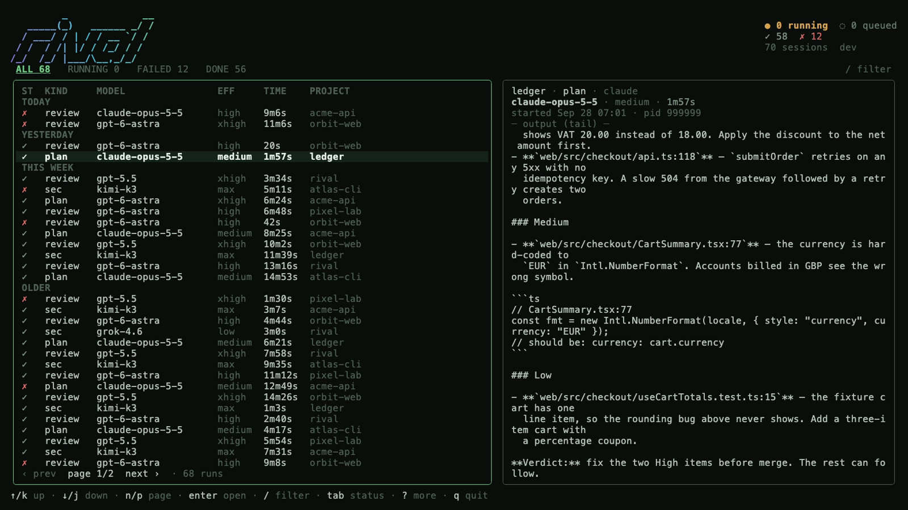

# Rival



Rival sends your code to another AI model for an independent review. It runs in the background while you keep working.

Browse sessions and findings in the terminal UI. Review changed code with Codex or Claude, or run a dedicated security review.

## Install

On macOS or Linux:

```bash
brew install 1905/tap/rival
rival install
```

Windows binaries and manual downloads are available on the [releases page](https://github.com/1905/rival/releases).

## Review skills

| Skill | What it does |
|---|---|
| `/rival-codex review` | Review changed code with Codex. |
| `/rival-claude review` | Review changed code with Claude. |
| `/rival-sol review` | Review changed code with Sol 6.1. |
| `/rival-fable review` | Review changed code with Fable 5.1. |
| `/rival-security` | Look for exploitable security vulnerabilities. |

## View the results

Run `rival tui` to browse reviews and their findings.

## Reference

Full installation steps, commands, configuration, and platform requirements are in the [command reference](docs/command-reference.md).

## License

[MIT](LICENSE)
