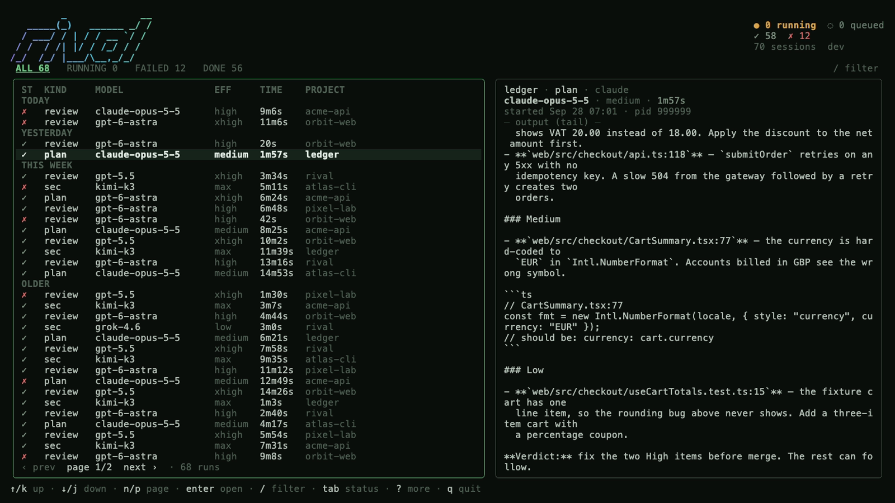

# Rival

> **Sunset — 2026-11-19.** Rival is no longer maintained. Use [T3 Code](https://github.com/pingdotgg/t3code) and its delegate subagents for new reviews and jobs. T3 provides model selection, child tasks, and result delivery directly.

## Use T3 delegates

1. Open your project in T3 Code and configure the providers you want to use.
2. Ask the agent:

   > Delegate subagent: review this branch against `origin/master` with my selected review model. Read-only. Return findings with severity, file and line, evidence, and a proposed fix. Start no further subagents.

3. The agent checks `orchestrator_capabilities`, selects an available model, and starts `delegate_task` with a complete task brief.
4. Wait for the completion result. Verify the findings before applying fixes. Use a fresh delegate for each independent review round.

For implementation jobs, name the files the delegate may edit and the checks it should run. Children do not inherit the parent conversation.
See the [T3 delegation documentation](https://github.com/pingdotgg/t3code/blob/main/docs/orchestration-v2/orchestrator-mcp-server.md).

The documentation below describes the retired software and remains for reference.

---



Rival sends your code to another AI model for an independent review. It runs in the background while you keep working.

Browse sessions and findings in the terminal UI. Review changed code with Codex or Claude, or run a dedicated security review.

## Install

On macOS or Linux:

```bash
brew install 1905/tap/rival
rival install
```

Windows binaries and manual downloads are available on the [releases page](https://github.com/1905/rival/releases).

## The /rival skill

`rival install` installs three skills for Claude Code and Codex: `/rival`, `/china`, and `/consilium`.

| Command | What it does |
|---|---|
| `/rival review` | Review the changed code. |
| `/rival review src/api/` | Review a specific scope. |
| `/rival -re high review` | Review with a different reasoning effort. |
| `/rival 'explain the auth flow'` | Run any prompt. |
| `/rival security` | Look for exploitable security vulnerabilities. |
| `/rival consilium [heavy] [scope]` | Run the 3-judge rated consilium review. |

By default, each host gets a review from the other vendor: `/rival` in Claude
Code runs Sol 6.2, and `/rival` in Codex runs Opus 5.5. To pick the models,
open the config window (`rival config`, Models), or run
`rival config set skill.claude <model>` and `rival config set skill.codex <model>`.
The models are `codex`, `sol`, `claude`, `fable`, `grok`, and `neon` (Gemini 4
Neon via `agy`, fixed at `xhigh` effort). The security review uses the `/china`
model (`china.model`, below).

## The /consilium skill

`/consilium` runs three independent judges in parallel and returns an overall
1–10 rating, a detailed subsection rating breakdown, and concrete findings from
each judge against a goal (bugs by default, or custom goals such as design fixes,
architecture, API ergonomics, or tests):

| Command | What it does |
|---|---|
| `/consilium` | 3-judge review of changed code (normal: Opus 5.5 + Sol 6.2 + Neon xhigh). |
| `/consilium src/api/` | Review a specific scope in normal mode. |
| `/consilium heavy src/api/` | Heavy mode (Fable 5.2 + Astra 6.2 + Neon xhigh). |
| `/consilium --goal 'design fixes' src/api/` | Rate and review against a custom goal. |

Ask `/consilium` to **hill-climb** a target for a goal until every judge reaches
9/10 (or a custom target score) to iterate automatically: each round fixes
confirmed findings prioritized by the lowest-scoring subsection and re-runs
the panel until all active judges meet the target. If Neon (or another judge)
fails or is unavailable, Rival skips it, notifies you with a `rival: ⚠` line,
and still returns the remaining judges' reviews. The command behind the skill
is `rival command consilium`.

Codex (GPT-6.2 Astra) and Sol 6.2 run at the Codex fast tier by default:
about 2x speed, using more of the plan's quota. To change it, set
`speed.codex` or `speed.sol` to `normal`, `fast` or `ultrafast` in the config
window or with `rival config set speed.sol normal`. Ultrafast needs the
Pro $500 plan, or an Enterprise/Edu workspace with Ultrafast on. On other
plans, Codex uses the standard tier and Rival prints a notice.

Version 6.0.0 replaces the per-model skills (`/rival-codex`, `/rival-sol`,
`/rival-claude`, `/rival-fable`, `/rival-k3`, `/rival-grok` and
`/rival-security`); `rival install` and `rival update` remove them. Plan
reviews remain available through `rival command plan`. See the
[skill migration details](docs/command-reference.md#skills).

## The /china skill

`rival install` also provides `/china` for Claude Code and Codex. It runs
one model through opencode v2: Kimi K3.1 Pro on opencode's `moonshot`
provider by default. Ask "review with china", or use the same input as
`/rival`:

| Command | What it does |
|---|---|
| `/china review` | Review the changed code. |
| `/china review src/api/` | Review a specific scope. |
| `/china -re high review` | Review with high instead of max reasoning. |
| `/china 'explain the auth flow'` | Run any prompt. |

The model is `china.model`, an opencode `provider/model` (default
`moonshot/kimi-k3.1-pro`). To change it, open the config window
(`rival config`, Models: `/CHINA RUNS`) and pick the provider (Moonshot or
OpenRouter) and a model from opencode's list, or run
`rival config set china.model <provider/model>`. The provider must be set up
in opencode with `opencode auth login` or a `{file:…}` key; Rival sends no
key and strips `MOONSHOT_*` variables from the child.
`-re` maps onto Moonshot's levels: `low` → low, `medium`/`high` → high,
`xhigh`/`ultra` → max. The default is max. Reviews run read-only, and the
reviewed repository's own opencode config is ignored. Raw prompts can edit
files in the workdir. The command behind the skill is `rival command china`.

The same model runs the security review (`/rival security`,
`rival command security`) at max effort. Kimi K3 (`rival command k3`,
`rival run k3`, `efforts.kimi-k3`) and the `security.reviewer` key are
removed. An old config that still has them loads, and Rival ignores them.

## View the results

Run `rival tui` to browse reviews and their findings.

## Reference

Full installation steps, commands, configuration, and platform requirements are in the [command reference](docs/command-reference.md).

## License

[MIT](LICENSE)
